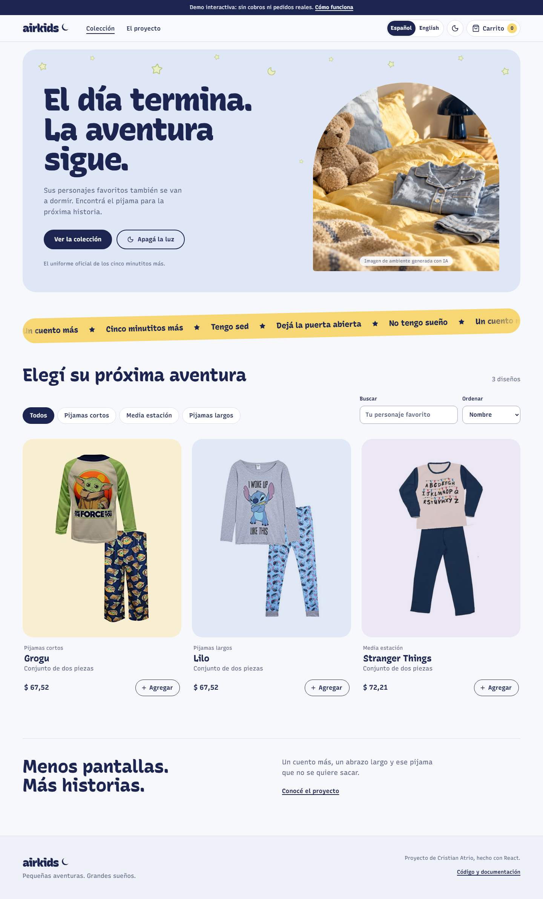
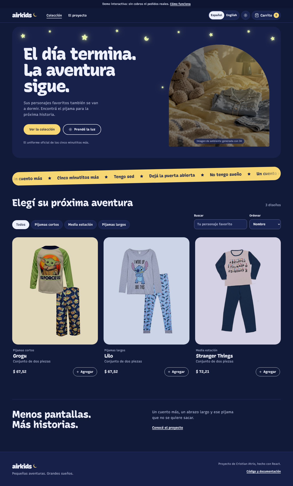
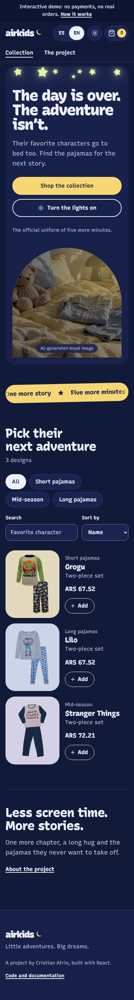
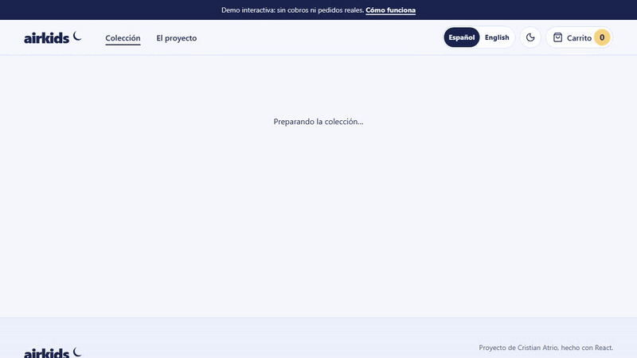

# AirKids · Pequeñas aventuras, grandes sueños

[English version](README.en.md)

Tienda de pijamas creada por **Cristian Atrio**, a partir de su proyecto final de React para Coderhouse. Catálogo, categorías, carrito persistente y checkout, en español e inglés, con modo noche y una interfaz adaptable a escritorio y celular.

> Inicia en **modo demo**: funciona sin credenciales, no envía datos personales, no registra pedidos reales y no realiza cobros. Conserva los tres diseños y precios ilustrativos del catálogo original.

| Modo noche                                    | Celular, en inglés                                          |
| --------------------------------------------- | ----------------------------------------------------------- |
|  |  |

## Probar en tu equipo

Requiere Node.js 22.12 o superior; recomendado: última versión de Node 22.

    npm ci
    npm run dev

Abrí la dirección indicada en la terminal. Cambiá el idioma con **Español / English** en el encabezado y apagá la luz con el botón de la luna. Buscá un personaje, agregalo desde el catálogo y completá el checkout con datos ficticios para obtener una referencia DEMO.

    npm run check
    npx playwright install chromium
    npx playwright test
    npm ci --prefix functions
    npm test --prefix functions
    npm audit
    npm audit --prefix functions

## Funcionalidades

- **Español e inglés**: detecta el idioma del navegador, recuerda la elección y actualiza textos, `lang` del documento, títulos de página y formato de precios.
- **Modo noche**: sigue la preferencia del sistema o el botón de la luz. La noche se extiende en un círculo desde el interruptor, las estrellas del techo titilan y cada tanto cruza una estrella fugaz.
- **Movimiento**: titulares que suben palabra por palabra, textos y fotos que aparecen al bajar, fichas que se inclinan hacia el cursor con un reflejo (de noche, una linterna), la foto que viaja de la ficha al detalle, el pijama que vuela al carrito y fichas que se reacomodan al filtrar u ordenar.
- Todo el movimiento respeta la preferencia de movimiento reducido. La cinta de excusas para no dormir tiene un botón de pausa que detiene todas las animaciones continuas y se recuerda (WCAG 2.2.2).
- Búsqueda, categorías y orden por precio.
- Agregado rápido desde el catálogo, con aviso para lectores de pantalla.
- Detalle y cantidades limitadas por stock, también editables dentro del carrito.
- Carrito persistente: guarda solo IDs y cantidades, nunca datos del comprador.
- Estados de carga, error, catálogo vacío, producto inexistente y página 404.
- Navegación por teclado, etiquetas visibles, foco visible y movimiento reducido.
- Confirmación de email con error junto al campo, bloqueo de doble envío y recuperación de errores.
- Firebase opcional: validación de precios en servidor y descuento transaccional de stock.
- CI y actualización de dependencias.

## Decisiones técnicas

| Herramienta                                                                          | Motivo                                                             |
| ------------------------------------------------------------------------------------ | ------------------------------------------------------------------ |
| [React](https://react.dev/)                                                          | Componentes y estado de la experiencia de compra.                  |
| [React Router](https://reactrouter.com/)                                             | Navegación sin recargas y URLs directas.                           |
| [Vite](https://vite.dev/)                                                            | Reemplaza Create React App con una base mantenida.                 |
| [Firebase](https://firebase.google.com/docs)                                         | Catálogo, autenticación anónima y función protegida de pedidos.    |
| [Recursive](https://www.recursive.design/) vía Fontsource                            | Una sola fuente variable: eje casual para títulos, lineal para UI. |
| [Lucide](https://lucide.dev/)                                                        | Íconos SVG consistentes en lugar de caracteres Unicode.            |
| [Vitest](https://vitest.dev/) y [Testing Library](https://testing-library.com/)      | Pruebas de comportamiento.                                         |
| [Playwright](https://playwright.dev/) y [axe](https://github.com/dequelabs/axe-core) | Recorridos completos y accesibilidad automática.                   |

Las traducciones son diccionarios propios en lugar de una librería de i18n: con dos idiomas y 139 textos por idioma, un contexto de React evita dependencias y una prueba garantiza que ambos idiomas tengan las mismas claves. Un script mínimo en `index.html` aplica idioma y tema antes del primer pintado para evitar destellos. La demo no depende de servicios externos.

Las animaciones usan solo APIs del navegador: CSS, IntersectionObserver, View Transitions, animaciones ligadas al scroll y Web Animations. Suman unos 5 KB comprimidos entre JS y CSS, sin librerías. Donde el navegador no admite una API, la página funciona igual sin ese efecto. `BrowserRouter` usa `useTransitions={false}` para que el cambio de ruta se pinte dentro de la transición de vista.

## Estructura

- src/App.jsx: proveedores, carga del catálogo y rutas.
- src/pages/: catálogo, detalle, carrito, checkout y página del proyecto.
- src/components/: encabezado, portada, ficha de producto y piezas compartidas.
- src/i18n.jsx y src/locales/: idioma activo y textos en español e inglés.
- src/theme.jsx y src/preferences.js: modo noche y preferencias guardadas.
- src/motion.js, src/useReveal.js, src/usePointerVars.js y src/useTransitionClick.js: transiciones de vista, apariciones al hacer scroll, posición del cursor y vuelo al carrito.
- src/cart.js y src/useCart.js: reglas inmutables y persistencia del carrito.
- src/data.js: catálogo demo y validaciones.
- src/services.js: adaptador demo/Firebase con carga bajo demanda.
- src/styles/: tokens de color y tipografía, base, encabezado, páginas y movimiento.
- functions/: pedidos validados en servidor.
- e2e/: pruebas en escritorio y celular.
- firestore.rules: política de acceso.

## Conectar Firebase

La demo está lista para publicarse. El modo Firebase necesita un proyecto configurado; no se modificó la base histórica.

1. Crear un proyecto con Firestore, Authentication anónima, Functions y App Check con reCAPTCHA v3. Functions puede requerir facturación.
2. Cargar documentos en productos con nombre, descripcion, tipo, precio, cantidad e imagen. Opcional: descripcionEn para la versión en inglés; sin ese campo se muestra la descripción en español. Tipos: Cortos, MediaEstacion o Largos. Imagen: nombre de archivo en public/images. Precio y stock numéricos; también se aceptan cadenas del catálogo histórico.
3. Instalar dependencias de functions. Con Firebase CLI autenticado, desplegar explícitamente al proyecto elegido:

       firebase deploy --project TU_PROYECTO --only firestore:rules,functions

4. Copiar .env.example a .env.local, establecer VITE_DATA_MODE=firebase y completar configuración web y clave de sitio de App Check. Registrar el dominio en Firebase y reCAPTCHA.
5. Compilar de nuevo. En un proyecto de prueba, verificar una orden, descuento de stock, rechazo de acceso directo y reintento con el mismo ID.

La función usa us-central1. El navegador envía IDs y cantidades; el servidor consulta precios y stock y guarda todo en una transacción. Solo el servidor accede a datos del comprador. El mismo ID de solicitud devuelve el mismo pedido.

**No incluye pagos, envíos, cancelaciones ni devolución automática de stock.** En Firebase, confirmar una orden descuenta unidades aunque no haya pago. Definir esos procesos antes de operar comercialmente. Las pruebas locales no certifican la configuración externa.

## Publicación

npm run build genera dist/. netlify.toml configura compilación, rutas SPA y encabezados. vercel.json y firebase.json incluyen alternativas con Vercel y Firebase Hosting. Sin variables se publica la demo. Nunca incluir claves privadas en variables VITE\_\*.

## Seguridad y créditos

Ver [SECURITY.md](SECURITY.md). Las imágenes y nombres de personajes se conservan como material académico original; no se afirma tener derechos comerciales sobre ellos. No se agregó una licencia a recursos de terceros.

La portada de ambiente fue generada con IA y se identifica como tal en la página. Las fotos de producto siguen siendo las originales; se presentan completas y nunca se amplían por encima de su resolución. Tipografía local: Recursive mediante Fontsource. Ver [dirección visual](docs/design.md).
